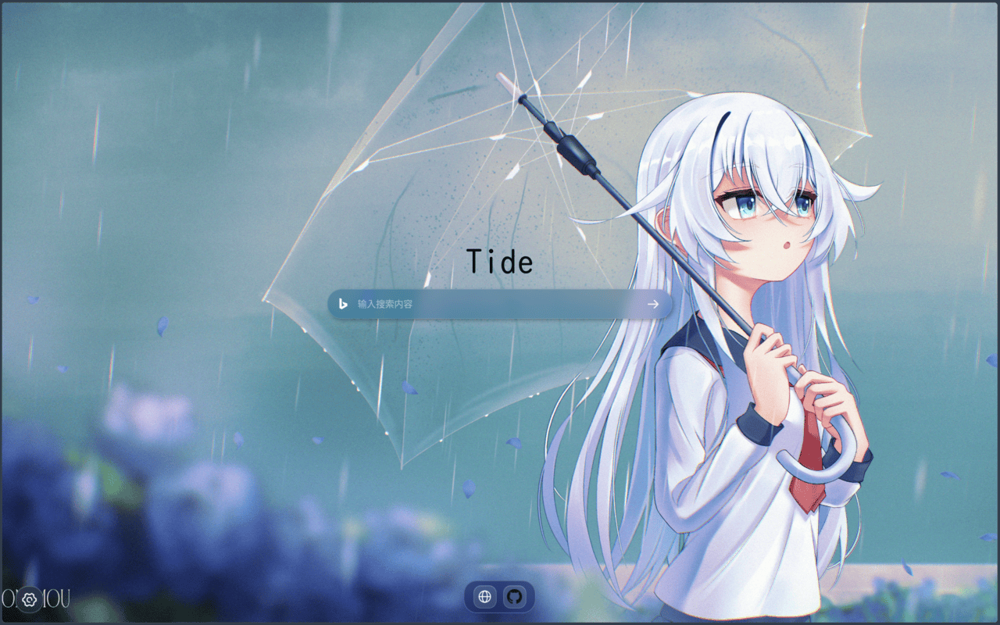
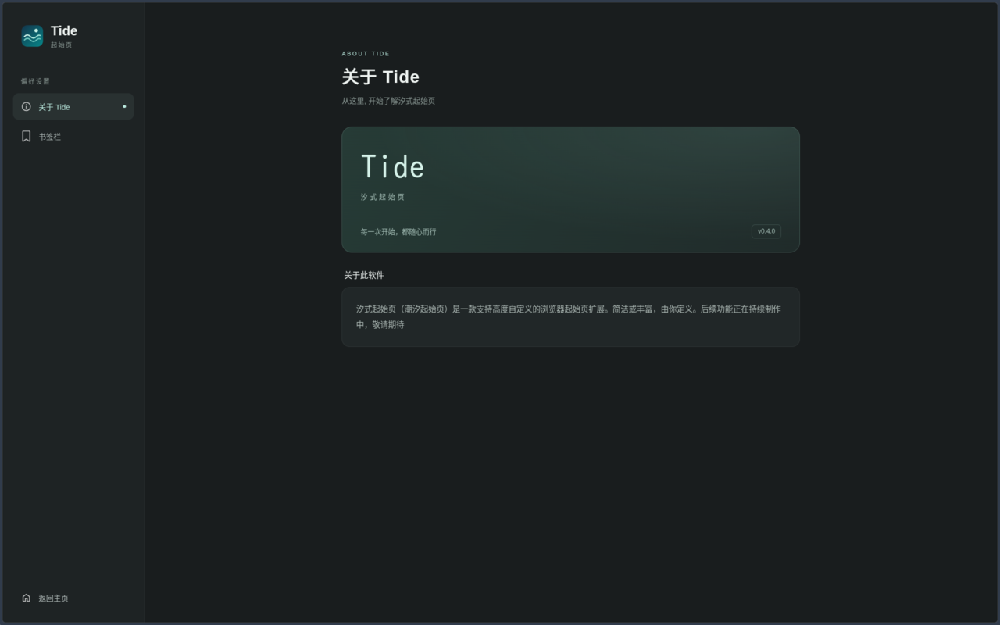
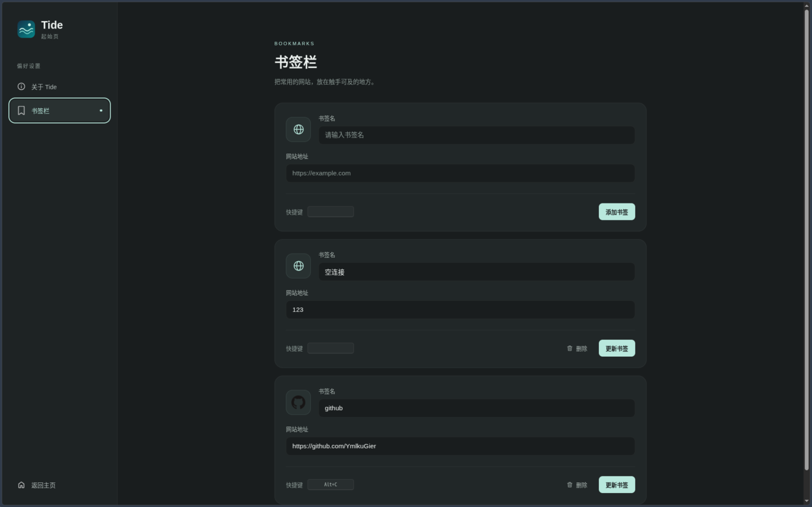

# 汐式起始页

## 一个简洁的本地起始页


### 📖 项目介绍

一个现代化、高个性化配置的浏览器起始页应用

### 🛠️ 技术栈

- **前端框架**: Vue 3.5.34 (Composition API)
- **开发语言**: TypeScript 6.0.3
- **构建工具**: Vite 8.0.11
- **路由管理**: Vue Router 4.6.4
- **本地数据存储**: Dexie 4.4.3
- **动画**: GSAP 3.15.0
- **工具库**: Lodash 4.18.1

### 👀 快速预览





### 📦 安装与运行

#### 环境要求

- Node.js >= 18.x
- npm >= 8.x

#### 快速开始

1. **克隆项目**
   ```bash
    git clone https://gitee.com/ymlku/tide_start_page.git
    cd tide_start_page
    ```
2. **安装依赖**
   ```bash
   npm install
   ```
3. **启动开发服务器**
   ```bash
   npm run dev
   ```
4. **构建生产版本**
   ```bash
   npm run build
   ```

### 📅 后续计划
- [x] 书签栏组件
- [ ] 自定义壁纸功能
- [ ] 翻译器组件